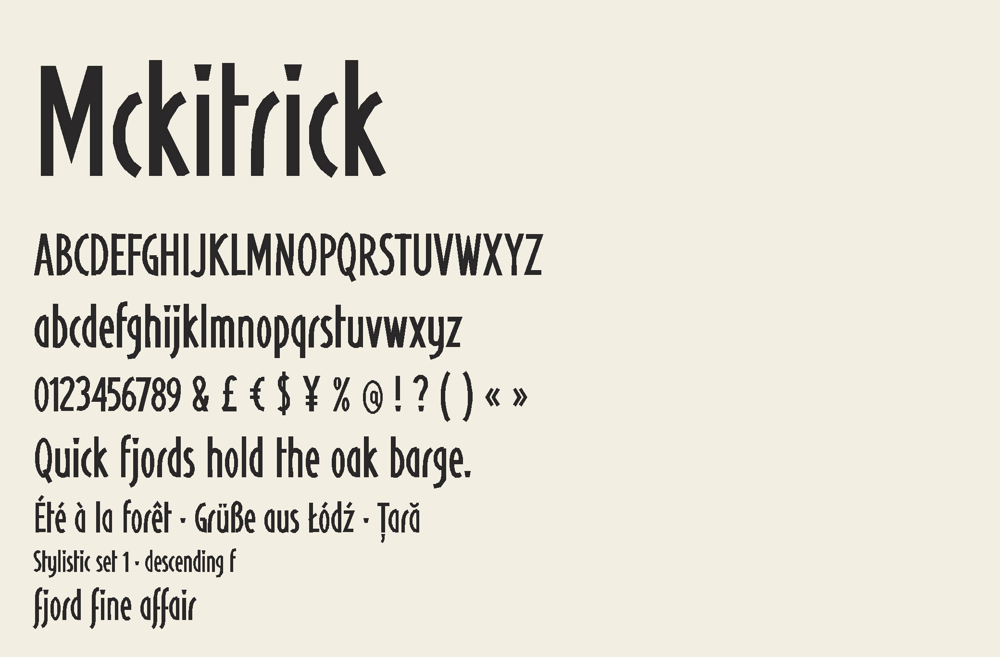
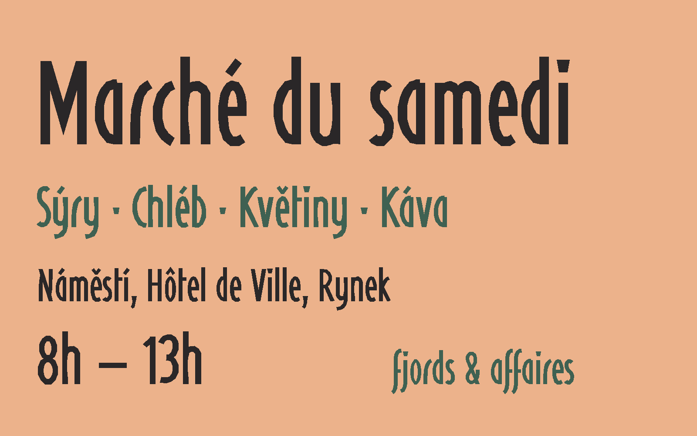
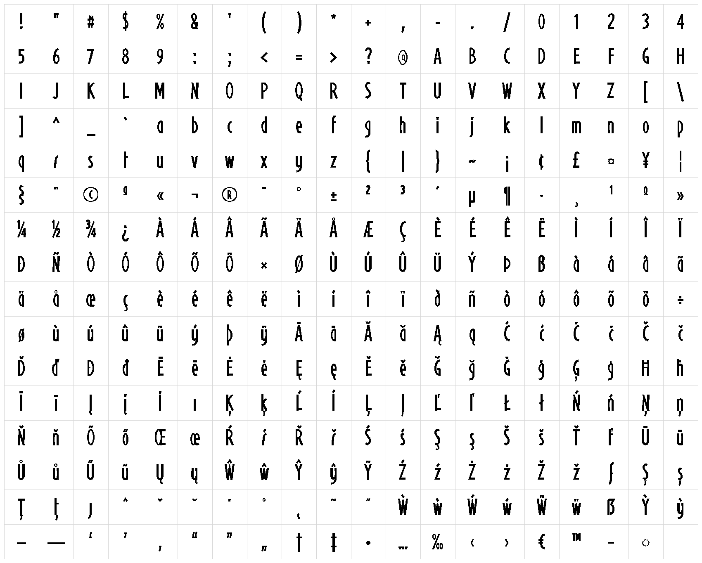
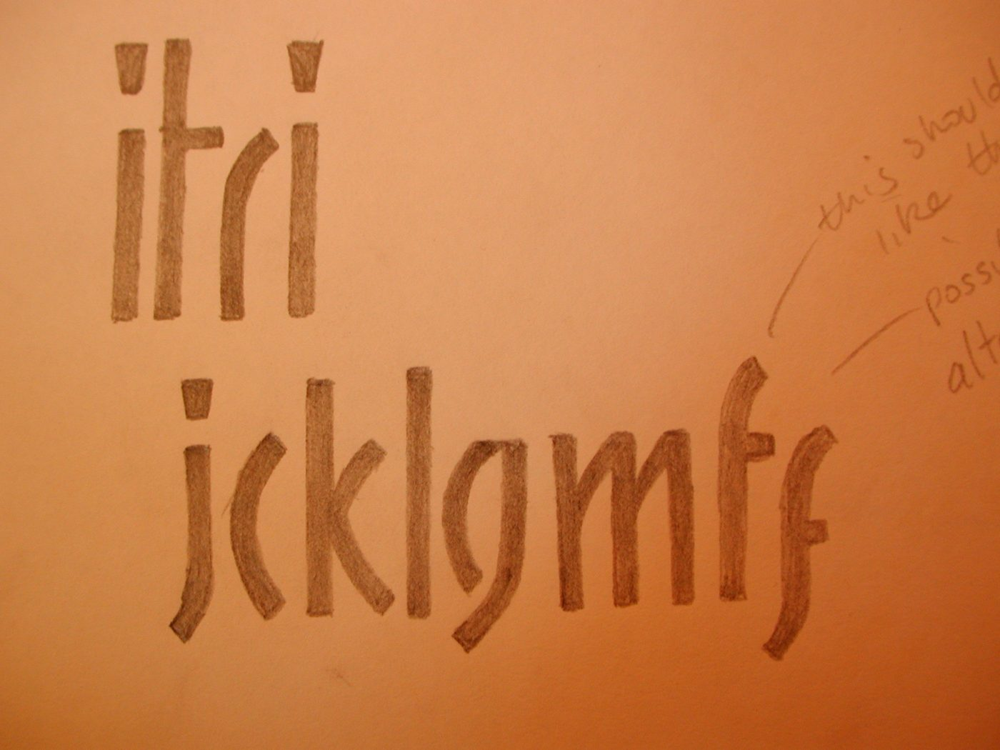

# Mckitrick



Mckitrick is a condensed display typeface drawn from a single sheet of hand-cut marker sketches. Every letter is built from separate, flat-ended strokes that stop short of one another where they meet, the way the originals were drawn. The dots on i and j are tapered, wider at the top, and the same dot carries through the punctuation and accents. The name comes from an old Celtic surname, McKitrick; the family is spelled Mckitrick to follow the Google Fonts naming rules.

It works best at display sizes: headings, posters, signs, labels and short lines of text.



## Features

- **Regular** weight, 338 glyphs
- **Google Fonts Latin Core** coverage: English and the Western, Central and Eastern European languages that use the Latin alphabet, including French, German, Spanish, Portuguese, Polish, Czech, Slovak, Hungarian, Romanian, Turkish, Croatian, Slovenian, Latvian, Lithuanian, Maltese and Welsh
- Combining accents with mark positioning, and soft-dotted i and j
- Smooth cubic outlines with points on extremes
- Optical spacing and class-based kerning, with exceptions so accents never collide
- Stylistic set 1 (`ss01`, also `salt`): an alternative **f** with a long descender



## Download and install

The fonts are in [`fonts/`](fonts):

| Folder | Format | Use |
|---|---|---|
| `fonts/otf` | OpenType (CFF) | Desktop apps on macOS and Windows |
| `fonts/ttf` | TrueType, hinted | Desktop apps, Android, older software |
| `fonts/webfonts` | WOFF2 | Websites |

- **macOS:** double-click `Mckitrick-Regular.otf`, then choose **Install Font**.
- **Windows:** right-click the file and choose **Install**.
- **Web:**

```css
@font-face {
  font-family: "Mckitrick";
  src: url("Mckitrick-Regular.woff2") format("woff2");
}
.descending-f { font-feature-settings: "ss01" 1; }
```

## Where it came from

Mckitrick began as ten pencil letters on apricot paper: **i t r i j c k l g m f**. The rest of the alphabet, the capitals, figures, punctuation and accented letters were drawn to match. The descending f is the alternative sketched in the margin of that first sheet.



## Building from source

Every glyph is defined as centre-line strokes in Python. The build expands the strokes to outlines, fits smooth Bézier curves, measures spacing and kerning, and writes a UFO source. The fonts are then compiled with [gftools builder](https://github.com/googlefonts/gftools), the Google Fonts toolchain.

```sh
pip install -r sources/requirements.txt
./build.sh
```

| File | Purpose |
|---|---|
| `sources/glyphs.py` | Every glyph, drawn as centre-line strokes with flat ends, plus accent anchors |
| `sources/fitcurves.py` | Fits cubic Bézier curves to the outlines, keeping corners sharp and adding extreme points |
| `sources/spacing.py` | Optical sidebearings and kerning measured from the outlines |
| `sources/build.py` | Writes `sources/Mckitrick-Regular.ufo` with outlines, anchors, kerning classes and features |
| `sources/config.yaml` | gftools builder configuration |
| `sources/sketch/` | The original hand-drawn sketch |

## Licence

Copyright 2026 The Mckitrick Project Authors.

This font software is licensed under the [SIL Open Font License, Version 1.1](OFL.txt). You can use it freely in personal and commercial work, and modify and redistribute it, as long as the fonts are not sold on their own and derivatives keep the same licence. The licence is available with a FAQ at <https://openfontlicense.org>.

## Author

Designed by [Ian Lawton](https://github.com/ianlawton). See [FONTLOG.txt](FONTLOG.txt) for the change history.
